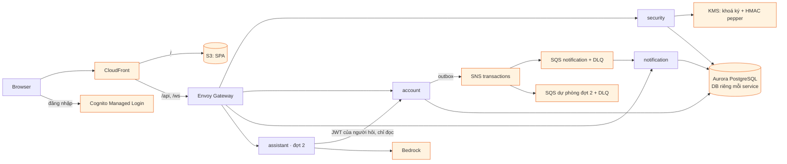

# minibank — Thiết kế ứng dụng

**Ngày:** 2026-10-26 · **Trạng thái:** bản nháp, chờ duyệt
**Phạm vi:** tầng ứng dụng. Hạ tầng (Terraform, EKS, mạng, account AWS) có tài liệu riêng, viết
sau khi tài liệu này được duyệt. Mục 12 liệt kê những gì tài liệu hạ tầng phải đáp ứng.

Quy ước trong tài liệu: **[user]** = người dùng đã chốt, **[claude]** = Claude đề xuất, người
dùng có thể đổi khi review.

---

## 1. Vì sao có dự án này

Đồ án tốt nghiệp. Trước đây dùng `banking-demo` (repo `kevinram164/banking-demo`, của người
khác) — không kiểm soát được source và CI, và không chứng minh được phần nào là của mình. Dự án
này thay thế nó bằng một app tự sở hữu từ đầu đến cuối.

Trọng tâm đồ án là **platform/DevOps trên AWS** (EKS + Terraform, CI DevSecOps, GitOps,
observability, AIOps) và **tối ưu chi phí**. App phải đủ thật để có chuyện mà vận hành, nhưng
không phải mục đích tự thân.

Hai mục tiêu ngang hàng **[user]**:
1. **Học được nhiều nhất.** Mỗi quyết định có lý do, có ADR, gắn với domain SAA-C03 tương ứng.
2. **Chi phí thấp trong thời gian dài** (~6 tháng). Không chạy 24/7.

### Mốc

| Đợt | Hạn (ước) | Phải có |
|---|---|---|
| 1 | cuối 12/2026 | Nghiệp vụ lõi chạy ổn trên EKS, CI/CD đầu–cuối, số đo baseline |
| 2 | ~4/2027 | Trợ lý AI trong app, AI chẩn đoán sự cố, SLO, scaling, DR, chaos |

### Cách làm việc **[user]**

Claude viết toàn bộ code, người dùng review. Hệ quả cho người build:
- Thay đổi nhỏ, từng phần một, dễ đọc. Ưu tiên rõ ràng hơn khéo léo.
- Mỗi quyết định không hiển nhiên phải ghi lý do (ADR ở `docs/adr/`) — người dùng phải tự
  bảo vệ được trước hội đồng.
- Claude **không commit/push**. Người dùng tự commit sau khi review.

## 2. Mục tiêu / ngoài phạm vi / không được xảy ra

**Mục tiêu (đợt 1):** khách hàng đăng ký, đăng nhập, có tài khoản với số dư demo, chuyển tiền
cho nhau, thanh toán cho merchant giả, xem lịch sử, nhận thông báo realtime khi có tiền vào.
Mọi giao dịch đổi tiền đều phải xác nhận bằng PIN giao dịch.

**Mục tiêu (đợt 2):** trợ lý tài chính hỏi–đáp bằng tiếng Việt về tiền của chính mình.

**Ngoài phạm vi:** tiền thật, liên kết ngân hàng/Napas thật, KYC, đa tiền tệ, vay/lãi, app
mobile, cổng nhân viên/admin (có thể bổ sung sau, không thuộc tài liệu này).

**Không được xảy ra (anti-goals):**
- Mất tiền hoặc tiền bị nhân đôi, dưới bất kỳ lỗi nào (retry, crash giữa chừng, gửi trùng).
- Số dư tài khoản khách âm.
- AI tự thực hiện bất kỳ thao tác ghi nào, hoặc thấy dữ liệu của người khác.
- Bí mật (khoá ký, pepper) nằm trong code, image, biến môi trường hay database.

## 3. Tổng quan kiến trúc



| Thành phần | Ngôn ngữ | Trách nhiệm |
|---|---|---|
| Cognito | — | Đăng ký, đăng nhập, access/refresh token của khách **[user]** |
| `security` | Go | PIN giao dịch, phát **token giao dịch**, công bố JWKS, quy trình xoay khoá **[user]** |
| `account` | Go | Tài khoản, sổ cái, chuyển tiền, thanh toán, lịch sử, outbox |
| `notification` | Go | Tiêu thụ sự kiện, lưu thông báo, WebSocket |
| `assistant` | Python | Trợ lý AI, đợt 2 **[user]** |
| frontend | React + Vite + TypeScript | SPA |

Ngôn ngữ: Go cho lõi, Python cho `assistant` **[user]**.

Không dùng Redis **[user]** — JWT thay session, Postgres LISTEN/NOTIFY thay pub/sub, hạn mức và
idempotency lưu trong Postgres. Chỉ thêm cache khi load test chứng minh cần.

Một Aurora cluster, **mỗi service một database và một user DB riêng**, không service nào đọc DB
của service khác **[claude]**. Ranh giới service được giữ thật mà không tốn thêm tiền.

## 4. Nghiệp vụ

### 4.1 Đăng ký và tài khoản

- Đăng ký/đăng nhập hoàn toàn qua Cognito (Managed Login, OAuth2 authorization code + PKCE).
- Tài khoản ngân hàng gắn với `sub` của Cognito. **Tạo lười**: request đầu tiên của một `sub`
  chưa có tài khoản sẽ tạo tài khoản, idempotent theo `sub` (unique constraint). Không dùng
  Lambda trigger.
- Tạo tài khoản đồng thời ghi **giao dịch mở tài khoản**: 10.000.000đ chuyển từ tài khoản hệ
  thống `BANK_FUNDING` sang **[claude]**.
- **Tên hiển thị [claude]:** Cognito bắt buộc thuộc tính `name` khi đăng ký. Lúc tạo tài khoản
  lười, `account` gọi endpoint `userInfo` của Cognito bằng chính access token (scope
  `openid profile`) để lấy tên, chuẩn hoá thành chữ hoa không dấu (`NGUYEN VAN AN`). Đợt 1
  không cho đổi tên.
- Số tài khoản: 10 chữ số, sinh ngẫu nhiên, unique, có chữ số kiểm tra (Luhn) để bắt gõ nhầm
  **[claude]**.
- Trước khi chuyển tiền lần đầu, khách phải đặt PIN (mục 6.2).

### 4.2 Chuyển tiền

- Theo số tài khoản người nhận. Trước khi xác nhận, frontend tra tên người nhận
  (`GET /accounts/lookup?number=`) để khách kiểm tra — trả tên hiển thị đã che bớt
  (VD `NGUYEN V. A`) **[claude]**.
- Số tiền: số nguyên VND, 1.000đ ≤ số tiền ≤ 50.000.000đ mỗi lần **[claude]**.
- Hạn mức ngày: tổng tiền ra (chuyển + thanh toán) ≤ 100.000.000đ/ngày theo giờ Việt Nam
  (Asia/Ho_Chi_Minh) **[claude]**.
- Ghi chú tuỳ chọn, ≤ 140 ký tự.
- Không được chuyển cho chính mình.
- Bắt buộc token giao dịch (mục 6.3) và `Idempotency-Key`.

### 4.3 Thanh toán merchant

- Danh sách merchant giả seed bằng migration, mỗi merchant là một tài khoản loại `MERCHANT` có
  `category`: `utilities` (điện, nước, internet), `food`, `shopping`, `transport`,
  `entertainment`. Tên chung chung, không dùng thương hiệu thật **[claude]**.
- Luồng giống chuyển tiền (cùng hạn mức, cùng PIN), khác ở người nhận chọn từ danh sách và giao
  dịch mang `category`.
- Mục đích: tạo dữ liệu chi tiêu có danh mục cho trợ lý AI đợt 2.

### 4.4 Lịch sử

- Danh sách giao dịch của tài khoản mình, mới nhất trước, phân trang bằng cursor.
- Lọc theo khoảng thời gian, chiều (vào/ra), danh mục.
- Mỗi dòng: thời gian, loại, đối tác (tên đã che), số tiền có dấu, ghi chú, số dư sau giao dịch.

### 4.5 Thông báo

- Khi có tiền vào (chuyển khoản đến), người nhận nhận thông báo realtime qua WebSocket và thấy
  trong danh sách thông báo (có trạng thái đã đọc).
- Người gửi không cần thông báo (đã thấy kết quả ngay trên màn hình).

## 5. Dữ liệu — `account`

### 5.1 Sổ cái ghi kép

Mọi thay đổi số dư đi qua sổ cái. Không có lệnh `UPDATE balance` nào nằm ngoài hàm ghi sổ.

| Bảng | Cột chính | Ràng buộc |
|---|---|---|
| `accounts` | `id`, `number`, `type` (`CUSTOMER`/`MERCHANT`/`SYSTEM`), `owner_sub` (null với merchant/system), `display_name`, `category` (merchant), `status`, `created_at` | `number` unique, `owner_sub` unique |
| `balances` | `account_id`, `balance` BIGINT, `allow_negative` BOOLEAN, `updated_at` | `CHECK (allow_negative OR balance >= 0)`. `allow_negative` chỉ `true` với tài khoản `SYSTEM`, đặt lúc tạo — CHECK chỉ nhìn được hàng của chính nó nên phải có cột này |
| `transactions` | `id`, `type` (`OPENING`/`TRANSFER`/`PAYMENT`), `initiator_account_id`, `idempotency_key`, `request_hash`, `amount`, `category`, `note`, `created_at` | unique (`initiator_account_id`, `idempotency_key`) |
| `postings` | `id`, `transaction_id`, `account_id`, `amount` BIGINT có dấu, `balance_after` | Tổng `amount` theo `transaction_id` = 0 |
| `used_jti` | `jti`, `expires_at` | `jti` primary key — chống phát lại token giao dịch |
| `outbox` | `id`, `event_id` UUID, `type`, `payload` JSONB, `trace_context`, `created_at`, `published_at` | |

Ghi chú:
- Kiểm "tổng postings = 0" bằng code trong cùng transaction và bằng test bất biến; Postgres
  không có CHECK theo nhóm hàng. Người build có thể chọn constraint trigger nếu muốn.
- `balances` tách khỏi `accounts` để khoá hàng hẹp nhất có thể.
- Dọn `used_jti` hết hạn định kỳ (người build chọn cách).

### 5.2 Thuật toán chuyển tiền

Một transaction Postgres duy nhất:

1. Tra `transactions` theo (`initiator`, `idempotency_key`) **trước tiên**:
   - đã có và `request_hash` giống → trả **lại đúng kết quả cũ** (HTTP 200, không ghi gì thêm),
     kể cả khi token giao dịch đã hết hạn hoặc `jti` đã dùng — retry hợp lệ, dù chậm, luôn nhận
     kết quả cũ;
   - đã có nhưng `request_hash` khác → 409.
2. Kiểm token giao dịch (mục 6.3): chữ ký, `exp`, `iss`, `aud`, claim khớp request.
3. `INSERT INTO used_jti … ON CONFLICT DO NOTHING` và kiểm số hàng chèn được — 0 hàng thì từ chối
   (phát lại). Không để lỗi unique làm hỏng cả transaction.
4. `SELECT … FOR UPDATE` hai hàng `balances`, **luôn theo thứ tự `account_id` tăng dần** để không
   deadlock.
5. Kiểm số dư đủ, kiểm hạn mức ngày (tổng tiền ra trong ngày từ `postings` của tài khoản).
6. Ghi `transactions`, 2 `postings`, cập nhật 2 `balances`, ghi 1 dòng `outbox`.
7. Commit.

Isolation: `READ COMMITTED` + khoá hàng là đủ; người build có thể chọn mạnh hơn nếu chứng minh
được cần.

### 5.3 Outbox relay

- Một goroutine trong `account` (không phải process riêng) **[claude]**: định kỳ lấy các dòng
  `published_at IS NULL` bằng `FOR UPDATE SKIP LOCKED`, publish lên SNS, đánh dấu
  `published_at`. Chạy nhiều replica vẫn an toàn nhờ `SKIP LOCKED`.
- Publish có thể lặp (crash sau publish, trước đánh dấu) → consumer bắt buộc idempotent.
- Dọn dòng đã publish cũ hơn 7 ngày.

## 6. Bảo mật

### 6.1 Xác thực khách hàng — Cognito

- Frontend dùng Managed Login + authorization code + PKCE (thư viện OIDC nhẹ như
  `oidc-client-ts`, người build chọn).
- Envoy Gateway kiểm access token Cognito qua JWKS của user pool cho mọi `/api/*`. Service vẫn
  kiểm lại (defense in depth) và lấy `sub` từ token, không bao giờ từ body.
- **Access token của Cognito không có claim `aud`** — nó có `client_id` và `token_use=access`.
  Cả Envoy lẫn service phải kiểm `iss`, `token_use` và `client_id`, không cấu hình kiểm `aud`
  (nếu có sẽ từ chối mọi request).
- `/ws` không qua kiểm JWT ở gateway (trình duyệt không gắn header được cho WebSocket) — xem 7.2.

### 6.2 PIN giao dịch — `security`

- 6 chữ số. Đặt lần đầu, đổi PIN (phải nhập PIN cũ).
- Lưu: `argon2id(HMAC_KMS(pepper_key, pin), salt)`. Salt 16 byte ngẫu nhiên mỗi người. HMAC
  thực hiện bằng **KMS GenerateMac** — pepper không bao giờ rời KMS.
- Lý do cần pepper: PIN chỉ có 10^6 khả năng, kẻ có bản sao DB thử hết được dù băm chậm đến
  đâu. Pepper trong KMS khiến bản sao DB vô dụng nếu không có quyền gọi KMS.
- Tham số Argon2id: theo khuyến nghị OWASP hiện hành (khởi điểm m=19 MiB, t=2, p=1), lưu kèm
  từng hash để nâng tham số sau mà không phá dữ liệu cũ. Tham số bộ nhớ ảnh hưởng RAM pod —
  ghi vào ADR.
- Sai 5 lần liên tiếp → khoá PIN 15 phút; đếm và khoá lưu trong DB **[claude]**.
- **Quên PIN [claude]:** đặt lại PIN không cần PIN cũ, nhưng chỉ khi access token Cognito có
  `auth_time` trong vòng 5 phút (vừa đăng nhập lại). Đặt lại xoá bộ đếm sai và khoá.
- **Xoay pepper [claude]:** KMS không tự xoay khoá HMAC, và đổi khoá thì hash cũ không kiểm được
  nữa. Mỗi hash lưu kèm `pepper_key_id`; khi khách nhập PIN đúng bằng khoá cũ, tính lại hash bằng
  khoá mới ngay lúc đó (rehash lười). Khoá cũ chỉ gỡ khi không còn hash nào dùng nó. Ghi vào ADR.
- Bảng `pins`: `sub`, `hash`, `salt`, `params`, `pepper_key_id`, `failed_count`, `locked_until`,
  `updated_at`.

### 6.3 Token giao dịch

Luồng:
1. Client gửi `POST /security/transaction-tokens` với PIN và **ý định giao dịch**: `type`,
   `to_account`, `amount`, `idempotency_key`.
2. `security` kiểm PIN, rồi ký JWT:
   - header: `alg=ES256`, `kid`
   - claim: `iss`, `aud=account`, `sub`, `jti`, `iat`, `exp = iat + 60s`, và `txn` =
     {`type`, `to_account`, `amount`, `idempotency_key`}
3. Client gọi `account` kèm access token Cognito **và** token giao dịch (header riêng, VD
   `X-Transaction-Token`).
4. `account` kiểm chữ ký bằng JWKS của `security` (cache, tải lại khi gặp `kid` lạ), kiểm
   `sub` khớp access token, kiểm `txn` khớp từng trường của request, rồi xử lý theo 5.2.

Ký bằng **khoá bất đối xứng KMS (ECC_NIST_P256, SIGN_VERIFY)** — khoá riêng không rời KMS.
KMS trả chữ ký ECDSA dạng DER; JWT ES256 cần dạng R‖S thô 64 byte — phải chuyển đổi, và có test
cho việc này.

### 6.4 JWKS và xoay khoá

- `security` công bố `/.well-known/jwks.json` gồm khoá công khai của mọi khoá ở trạng thái
  `PENDING`, `ACTIVE` hoặc `VERIFY_ONLY` — khoá `PENDING` phải có mặt sẵn để bên kiểm biết nó
  trước khi nó bắt đầu ký.
- Bảng `signing_keys`: `kid`, `kms_key_arn`, `status` (`PENDING`/`ACTIVE`/`VERIFY_ONLY`/
  `RETIRED`), `created_at`, `activated_at`, `retired_at`. Đúng một khoá `ACTIVE`.
- Quy trình xoay (KMS không tự xoay khoá bất đối xứng):
  1. Khoá KMS mới do Terraform tạo (PR vào `minibank-infra` — service không có quyền tạo khoá),
     rồi đăng ký vào `signing_keys` → `PENDING`, xuất hiện trong JWKS.
  2. Chờ ≥ TTL cache JWKS của các bên kiểm.
  3. Đổi khoá mới → `ACTIVE`, khoá cũ → `VERIFY_ONLY`.
  4. Chờ ≥ TTL token (60s) + biên an toàn.
  5. Khoá cũ → `RETIRED`, gỡ khỏi JWKS, lên lịch xoá trong KMS.
- Kích hoạt bằng lệnh quản trị (CLI hoặc endpoint nội bộ không ra ngoài gateway), không tự động
  theo lịch ở đợt 1 **[claude]**.
- Tiêu chí: xoay khoá giữa lúc load test, **0 giao dịch lỗi**.

### 6.5 Nguyên tắc chung

- Service lấy credential AWS qua EKS Pod Identity, không có access key.
- Không log PIN, token, số tài khoản đầy đủ (che còn 4 số cuối).
- Mọi input validate ở biên service; lỗi trả theo một định dạng thống nhất (RFC 9457
  problem+json) **[claude]**.

## 7. Thông báo — `notification`

### 7.1 Đường đi sự kiện

`account` outbox → SNS topic `transactions` → SQS `notification` (raw message delivery, DLQ sau
5 lần nhận) → `notification`.

Sự kiện `TransactionCompleted`: `event_id`, `transaction_id`, `type`, `from_account`,
`from_owner_sub`, `to_account`, `to_owner_sub` (null nếu người nhận là merchant/system),
`amount`, `category`, `note`, `occurred_at`. Trace context đi theo message attribute
`traceparent`.

**Mọi loại giao dịch (`OPENING`, `TRANSFER`, `PAYMENT`) đều ghi outbox [claude]** — đợt 2
(assistant, audit) cần đủ. `notification` chỉ tạo thông báo khi `to_owner_sub` khác null và
`type = TRANSFER`; sự kiện khác thì xác nhận rồi bỏ qua.

Consumer: lưu vào `notifications` với `event_id` unique (trùng thì bỏ qua) → `NOTIFY` lên kênh
Postgres → mọi pod `notification` nhận, pod nào đang giữ WebSocket của `to_owner_sub` thì đẩy
xuống. Chỉ xoá message SQS sau khi đã commit DB.

Bảng `notifications`: `id`, `user_sub`, `seq`, `event_id` unique, `type`, `payload` JSONB,
`created_at`, `read_at`. Unique (`user_sub`, `seq`).

**Thứ tự gửi bù [claude]:** id tăng dần của Postgres *không* theo thứ tự commit — với nhiều
consumer, id 10 có thể commit sau id 11, và client đã nhận 11 sẽ không bao giờ được bù 10.
Vì vậy mỗi người dùng có bộ đếm riêng (`user_seq(user_sub, seq)`), tăng bằng
`UPDATE … RETURNING` trong cùng transaction chèn thông báo. Khoá hàng giữ tới commit nên với
cùng một người dùng, `seq` luôn commit theo thứ tự. Gửi bù dựa trên `seq`, không dựa trên `id`.

### 7.2 WebSocket

- Xác thực: sau khi mở kết nối, client gửi message đầu tiên `{type:"auth", token, last_seq}`.
  Không nhận được trong 5 giây hoặc token sai → đóng. Không đặt token trên query string (lọt
  vào log) **[claude]**.
- Sau khi xác thực, server gửi bù mọi thông báo có `seq > last_seq` rồi mới đẩy realtime → không
  sót khi mất kết nối. Client bỏ qua thông báo có `seq` đã nhận.
- Client tự kết nối lại với exponential backoff + jitter.
- Token hết hạn giữa chừng: server đóng kết nối với mã riêng, client lấy token mới rồi nối lại.
- Pod nhận SIGTERM: ngừng nhận kết nối mới, đóng kết nối hiện có với mã "going away" để client
  nối sang pod khác.

## 8. Trợ lý AI — `assistant` (đợt 2)

Thiết kế chi tiết làm ở đợt 2. Ràng buộc đã chốt:
- Python, gọi model qua Amazon Bedrock (Converse API, tool use).
- Tool chỉ đọc, gọi API của `account` **bằng chính access token của người hỏi** — không có
  quyền riêng, không thấy dữ liệu người khác.
- Không có tool nào ghi. Câu hỏi kiểu "chuyển giúp tôi…" được trả lời bằng hướng dẫn, không thực
  hiện.
- Ghi chú chuyển khoản, tên tài khoản là dữ liệu do người khác nhập → đưa vào prompt như dữ
  liệu có đánh dấu, không như chỉ dẫn (chống prompt injection). Có bộ test injection.
- Giới hạn số câu hỏi mỗi người mỗi ngày để chặn chi phí.
- Queue SQS thứ hai trên topic `transactions` để dành cho đợt 2 (assistant/audit); đợt 1 có thể
  chưa tạo.

## 9. Observability **[user: Grafana Cloud]**

- Code: OpenTelemetry SDK cho metrics + traces; `log/slog` JSON ra stdout, mỗi dòng có
  `trace_id`, `span_id`.
- Trace xuyên suốt: HTTP → SQL → SNS publish → SQS receive → WebSocket push. Context qua SNS/SQS
  bằng message attribute.
- Metric nghiệp vụ tối thiểu: giao dịch theo loại và kết quả, tiền chuyển (histogram), PIN sai,
  PIN bị khoá, outbox chưa publish (gauge), độ trễ outbox, số kết nối WebSocket, thông báo gửi
  bù.
- Endpoint: `/livez` (process sống), `/readyz` (DB sẵn sàng). Metric đẩy OTLP qua collector
  (Grafana Alloy) — không bắt buộc `/metrics` kiểu Prometheus; người build chọn.
- Thu gom và đẩy lên Grafana Cloud là việc của tài liệu hạ tầng.

## 10. Yêu cầu vận hành với mọi service

- Stateless; cấu hình qua biến môi trường; bí mật lấy lúc chạy (KMS, Secrets Manager qua
  External Secrets), không nằm trong image.
- Tắt êm khi SIGTERM trong ≤ 25 giây.
- Image đa kiến trúc `linux/arm64` + `linux/amd64` (node dự kiến là Graviton), distroless,
  chạy non-root.
- Migration chạy như một bước riêng trước khi deploy (Job), không chạy lúc service khởi động —
  tránh lặp lại lỗi `create_all()` đua nhau của banking-demo.
- **Kết nối DB bằng IAM database authentication [claude]**: service lấy token xác thực DB qua
  Pod Identity, không có mật khẩu nào. Token sống 15 phút nên pool phải sinh token mới mỗi lần mở
  kết nối (hook `BeforeConnect` của pgx). Mật khẩu master của Aurora do RDS tự quản trong Secrets
  Manager, chỉ dùng cho bước bootstrap tạo database và user cho từng service. Bootstrap đó do
  ai chạy (Terraform hay Job) là việc của tài liệu hạ tầng. Khi chạy local: mật khẩu thường
  trong `compose.yaml`.
- **Aurora 0 ACU** chỉ tạm dừng khi không còn kết nối nào, và mất ~15 giây để thức dậy. Đầu buổi
  làm, `/readyz` và Job migration phải chịu được độ trễ này (retry có backoff, timeout đủ dài).
- Mọi gọi AWS đi qua interface để chạy local và test được không cần AWS: `EventPublisher`,
  `Signer`, `Pepper`. Bản local dùng khoá trong file / HMAC cục bộ; bản AWS dùng KMS/SNS.

## 11. Repo và chạy local **[claude]**

```
minibank/
  services/security/      Go
  services/account/       Go
  services/notification/  Go
  services/assistant/     Python (đợt 2)
  internal/platform/      Go dùng chung: OTel, logging, middleware xác thực, lỗi
  frontend/               React + Vite + TS
  docs/adr/               mỗi quyết định một file, ghi domain SAA-C03 liên quan
  docs/superpowers/       spec, plan
  compose.yaml            chạy local
```

- Một Go module ở gốc repo.
- Chạy local bằng Docker Compose: Postgres + 3 service + frontend dev server. SNS/SQS local:
  người build chọn giữa ElasticMQ (chỉ SQS, publisher local ghi thẳng vào queue) hoặc LocalStack
  (kiểm điều kiện license hiện hành trước khi dùng).
- Cognito khi chạy local: dùng **user pool dev thật** trên AWS (miễn phí ở mức demo, nằm trong
  stack persistent) **[claude]**. Test tự động không phụ thuộc Cognito: middleware xác thực nhận
  issuer/JWKS cấu hình được, test dùng issuer giả.

## 12. Yêu cầu đối với tài liệu hạ tầng (viết sau)

Đã chốt cùng người dùng, tài liệu hạ tầng phải hiện thực:
- EKS + Terraform, không chạy 24/7; tách stack **persistent** (gần như $0 khi rảnh) và
  **ephemeral** (apply/destroy theo buổi làm).
- Aurora PostgreSQL Serverless v2, min 0 ACU, nằm trong stack persistent.
- Cognito user pool, KMS (1 khoá ký, 1 khoá HMAC), SNS/SQS + DLQ, ECR, S3 + CloudFront cho SPA.
- Envoy Gateway kiểm JWT Cognito.
- Observability đẩy lên Grafana Cloud.
- Tham khảo series Vikki banking (devopsvn.tech), thu nhỏ có chủ đích.

Chi tiết hạ tầng: xem [thiết kế hạ tầng](2026-10-26-minibank-infra-design.md).

## 13. Kiểm thử và tiêu chí nghiệm thu

| Loại | Nội dung |
|---|---|
| Unit | Nghiệp vụ sổ cái, hạn mức, kiểm claim token, Argon2id + pepper |
| Integration | Postgres thật qua testcontainers cho từng service |
| Bất biến tiền | N goroutine chuyển chéo đồng thời giữa M tài khoản → tổng tiền hệ thống không đổi, không số dư khách âm, không deadlock treo |
| Idempotency | Gửi lại cùng request + key → cùng kết quả, chỉ 1 giao dịch; khác body cùng key → 409 |
| Phát lại | Dùng lại token giao dịch cho request khác → từ chối |
| Thông báo | Sự kiện trùng → 1 thông báo; mất WS rồi nối lại với `last_id` → không sót |
| Xoay khoá | Xoay giữa load test → 0 lỗi |
| E2E | Kịch bản demo: 2 người dùng đăng ký, đặt PIN, A chuyển cho B, B nhận realtime, A thanh toán merchant, lịch sử đúng |

**Chạy ở đâu [claude]:**
- **CI (GitHub Actions)** chạy unit, integration, bất biến tiền, idempotency, phát lại, thông
  báo, và logic xoay khoá với `Signer` local. Không cần AWS credential, không cần Cognito: dùng
  issuer giả.
- **Trên môi trường EKS** chạy E2E với Cognito và KMS thật, và thí nghiệm xoay khoá giữa load
  test. Script lấy token bằng `AdminInitiateAuth` (`ADMIN_USER_PASSWORD_AUTH`) trên một app client
  riêng cho test, với user test tạo bằng API admin. App client của người dùng thật vẫn chỉ cho
  phép authorization code + PKCE.

Nghiệm thu đợt 1 (phần app): mọi kiểm thử chạy trên CI đều xanh, và E2E cùng thí nghiệm xoay
khoá đạt trên EKS.

## 14. Để lại cho người build

- Router, thư viện cụ thể (đề xuất: `chi`, `pgx` + `sqlc`, `goose`, `coder/websocket`,
  `aws-sdk-go-v2`), cấu trúc package bên trong từng service.
- Hình thức API chi tiết (đường dẫn, mã lỗi) trong khuôn khổ tài liệu này; có OpenAPI cho mỗi
  service.
- Thiết kế giao diện frontend.
- Cách dọn `used_jti`, `outbox`.
